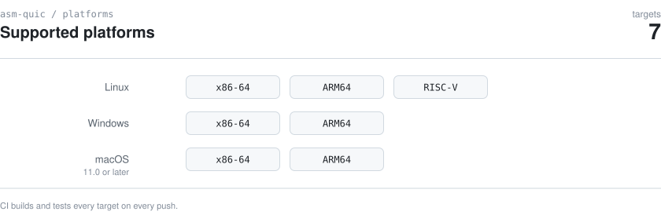
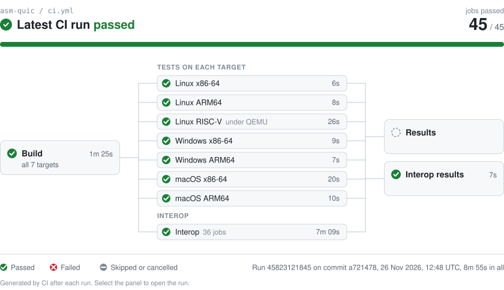

# asm-quic

QUIC version 1 with TLS 1.3 in the libp2p TLS profile, for an Ethereum consensus client, in assembly.

Standard: [asm-standard@0db3e07](https://github.com/bitminetech/asm-standard/blob/0db3e07f58a9ba89c5b6a46925b179de265ee7e8/ARCHITECTURE.md)

<!-- CI generates the supported platforms panel here. -->
<table><tr><td>

<picture><source media="(prefers-color-scheme: dark)" srcset="docs/readme/platforms-dark.svg"></picture>

</td></tr></table>
<!-- End of the supported platforms panel. -->

<!-- CI generates the verification heatmap here. -->
<table><tr><td>

<picture><source media="(prefers-color-scheme: dark)" srcset="docs/heatmap/header-dark.svg"></picture>

<picture><source media="(prefers-color-scheme: dark)" srcset="docs/heatmap/label-certificates-dark.svg"></picture><a href="docs/reference/certificates.md#function-quic_cert_verify"><picture><source media="(prefers-color-scheme: dark)" srcset="docs/heatmap/cell-0-dark.svg"></picture></a><a href="docs/reference/certificates.md#function-quic_cert_check"><picture><source media="(prefers-color-scheme: dark)" srcset="docs/heatmap/cell-0-dark.svg"></picture></a><a href="docs/reference/certificates.md#function-quic_der_next"><picture><source media="(prefers-color-scheme: dark)" srcset="docs/heatmap/cell-0-dark.svg"></picture></a><a href="docs/reference/certificates.md#function-quic_der_take"><picture><source media="(prefers-color-scheme: dark)" srcset="docs/heatmap/cell-0-dark.svg"></picture></a><a href="docs/reference/certificates.md#function-quic_bytes_is"><picture><source media="(prefers-color-scheme: dark)" srcset="docs/heatmap/cell-0-dark.svg"></picture></a><a href="docs/reference/certificates.md#function-quic_der_digits"><picture><source media="(prefers-color-scheme: dark)" srcset="docs/heatmap/cell-0-dark.svg"></picture></a><a href="docs/reference/certificates.md#function-quic_der_time"><picture><source media="(prefers-color-scheme: dark)" srcset="docs/heatmap/cell-0-dark.svg"></picture></a><a href="docs/reference/certificates.md#function-quic_der_int_get"><picture><source media="(prefers-color-scheme: dark)" srcset="docs/heatmap/cell-0-dark.svg"></picture></a><a href="docs/reference/certificates.md#function-quic_der_sig_get"><picture><source media="(prefers-color-scheme: dark)" srcset="docs/heatmap/cell-0-dark.svg"></picture></a><a href="docs/reference/certificates.md#function-quic_der_int_put"><picture><source media="(prefers-color-scheme: dark)" srcset="docs/heatmap/cell-0-dark.svg"></picture></a><a href="docs/reference/certificates.md#function-quic_der_sig_put"><picture><source media="(prefers-color-scheme: dark)" srcset="docs/heatmap/cell-0-dark.svg"></picture></a><a href="docs/reference/certificates.md#function-quic_low_s"><picture><source media="(prefers-color-scheme: dark)" srcset="docs/heatmap/cell-0-dark.svg"></picture></a><a href="docs/reference/certificates.md#function-quic_cert_alg"><picture><source media="(prefers-color-scheme: dark)" srcset="docs/heatmap/cell-0-dark.svg"></picture></a><a href="docs/reference/certificates.md#function-quic_cert_spki"><picture><source media="(prefers-color-scheme: dark)" srcset="docs/heatmap/cell-0-dark.svg"></picture></a><a href="docs/reference/certificates.md#function-quic_cert_exts"><picture><source media="(prefers-color-scheme: dark)" srcset="docs/heatmap/cell-0-dark.svg"></picture></a><a href="docs/reference/certificates.md#function-quic_ext_understood"><picture><source media="(prefers-color-scheme: dark)" srcset="docs/heatmap/cell-0-dark.svg"></picture></a><a href="docs/reference/certificates.md#function-quic_pb_key"><picture><source media="(prefers-color-scheme: dark)" srcset="docs/heatmap/cell-0-dark.svg"></picture></a><a href="docs/reference/certificates.md#function-quic_cert_selfsig"><picture><source media="(prefers-color-scheme: dark)" srcset="docs/heatmap/cell-0-dark.svg"></picture></a><a href="docs/reference/certificates.md#function-quic_host_verify"><picture><source media="(prefers-color-scheme: dark)" srcset="docs/heatmap/cell-0-dark.svg"></picture></a><a href="docs/reference/certificates.md#function-quic_der_wrap"><picture><source media="(prefers-color-scheme: dark)" srcset="docs/heatmap/cell-0-dark.svg"></picture></a><a href="docs/reference/certificates.md#function-quic_cert_build"><picture><source media="(prefers-color-scheme: dark)" srcset="docs/heatmap/cell-0-dark.svg"></picture></a> 
<picture><source media="(prefers-color-scheme: dark)" srcset="docs/heatmap/label-connections-dark.svg"></picture><a href="docs/reference/connections.md#function-quic_conn_new"><picture><source media="(prefers-color-scheme: dark)" srcset="docs/heatmap/cell-0-dark.svg"></picture></a><a href="docs/reference/connections.md#function-quic_conn_free"><picture><source media="(prefers-color-scheme: dark)" srcset="docs/heatmap/cell-0-dark.svg"></picture></a><a href="docs/reference/connections.md#function-quic_space"><picture><source media="(prefers-color-scheme: dark)" srcset="docs/heatmap/cell-0-dark.svg"></picture></a><a href="docs/reference/connections.md#function-quic_conn_find"><picture><source media="(prefers-color-scheme: dark)" srcset="docs/heatmap/cell-0-dark.svg"></picture></a><a href="docs/reference/connections.md#function-quic_conn_find_odcid"><picture><source media="(prefers-color-scheme: dark)" srcset="docs/heatmap/cell-0-dark.svg"></picture></a><a href="docs/reference/connections.md#function-quic_pto_period"><picture><source media="(prefers-color-scheme: dark)" srcset="docs/heatmap/cell-0-dark.svg"></picture></a><a href="docs/reference/connections.md#function-quic_conn_close"><picture><source media="(prefers-color-scheme: dark)" srcset="docs/heatmap/cell-0-dark.svg"></picture></a><a href="docs/reference/connections.md#function-quic_conn_drain"><picture><source media="(prefers-color-scheme: dark)" srcset="docs/heatmap/cell-0-dark.svg"></picture></a><a href="docs/reference/connections.md#function-quic_close_timer"><picture><source media="(prefers-color-scheme: dark)" srcset="docs/heatmap/cell-0-dark.svg"></picture></a><a href="docs/reference/connections.md#function-quic_discard_space"><picture><source media="(prefers-color-scheme: dark)" srcset="docs/heatmap/cell-0-dark.svg"></picture></a><a href="docs/reference/connections.md#function-quic_confirm"><picture><source media="(prefers-color-scheme: dark)" srcset="docs/heatmap/cell-0-dark.svg"></picture></a><a href="docs/reference/connections.md#function-quic_idle_reset"><picture><source media="(prefers-color-scheme: dark)" srcset="docs/heatmap/cell-0-dark.svg"></picture></a> 
<picture><source media="(prefers-color-scheme: dark)" srcset="docs/heatmap/label-node-dark.svg"></picture><a href="docs/reference/node.md#function-quic_state_size"><picture><source media="(prefers-color-scheme: dark)" srcset="docs/heatmap/cell-0-dark.svg"></picture></a><a href="docs/reference/node.md#function-quic_init"><picture><source media="(prefers-color-scheme: dark)" srcset="docs/heatmap/cell-0-dark.svg"></picture></a><a href="docs/reference/node.md#function-quic_step"><picture><source media="(prefers-color-scheme: dark)" srcset="docs/heatmap/cell-0-dark.svg"></picture></a><a href="docs/reference/node.md#function-quic_layout"><picture><source media="(prefers-color-scheme: dark)" srcset="docs/heatmap/cell-0-dark.svg"></picture></a><a href="docs/reference/node.md#function-quic_check_addr"><picture><source media="(prefers-color-scheme: dark)" srcset="docs/heatmap/cell-0-dark.svg"></picture></a><a href="docs/reference/node.md#function-quic_check_event"><picture><source media="(prefers-color-scheme: dark)" srcset="docs/heatmap/cell-0-dark.svg"></picture></a><a href="docs/reference/node.md#function-quic_event"><picture><source media="(prefers-color-scheme: dark)" srcset="docs/heatmap/cell-0-dark.svg"></picture></a><a href="docs/reference/node.md#function-quic_on_dial"><picture><source media="(prefers-color-scheme: dark)" srcset="docs/heatmap/cell-0-dark.svg"></picture></a><a href="docs/reference/node.md#function-quic_on_close"><picture><source media="(prefers-color-scheme: dark)" srcset="docs/heatmap/cell-0-dark.svg"></picture></a><a href="docs/reference/node.md#function-quic_connections"><picture><source media="(prefers-color-scheme: dark)" srcset="docs/heatmap/cell-0-dark.svg"></picture></a><a href="docs/reference/node.md#function-quic_conn_timers"><picture><source media="(prefers-color-scheme: dark)" srcset="docs/heatmap/cell-0-dark.svg"></picture></a><a href="docs/reference/node.md#function-quic_conn_tell"><picture><source media="(prefers-color-scheme: dark)" srcset="docs/heatmap/cell-0-dark.svg"></picture></a><a href="docs/reference/node.md#function-quic_conn_deadline"><picture><source media="(prefers-color-scheme: dark)" srcset="docs/heatmap/cell-0-dark.svg"></picture></a><a href="docs/reference/node.md#function-quic_copy"><picture><source media="(prefers-color-scheme: dark)" srcset="docs/heatmap/cell-0-dark.svg"></picture></a><a href="docs/reference/node.md#function-quic_zero"><picture><source media="(prefers-color-scheme: dark)" srcset="docs/heatmap/cell-0-dark.svg"></picture></a><a href="docs/reference/node.md#function-quic_equal"><picture><source media="(prefers-color-scheme: dark)" srcset="docs/heatmap/cell-0-dark.svg"></picture></a><a href="docs/reference/node.md#function-quic_heap_alloc"><picture><source media="(prefers-color-scheme: dark)" srcset="docs/heatmap/cell-0-dark.svg"></picture></a><a href="docs/reference/node.md#function-quic_heap_free"><picture><source media="(prefers-color-scheme: dark)" srcset="docs/heatmap/cell-0-dark.svg"></picture></a><a href="docs/reference/node.md#function-quic_heap_room"><picture><source media="(prefers-color-scheme: dark)" srcset="docs/heatmap/cell-0-dark.svg"></picture></a><a href="docs/reference/node.md#function-quic_random"><picture><source media="(prefers-color-scheme: dark)" srcset="docs/heatmap/cell-0-dark.svg"></picture></a><a href="docs/reference/node.md#function-quic_reseed"><picture><source media="(prefers-color-scheme: dark)" srcset="docs/heatmap/cell-0-dark.svg"></picture></a><a href="docs/reference/node.md#function-quic_action"><picture><source media="(prefers-color-scheme: dark)" srcset="docs/heatmap/cell-0-dark.svg"></picture></a><a href="docs/reference/node.md#function-quic_room"><picture><source media="(prefers-color-scheme: dark)" srcset="docs/heatmap/cell-0-dark.svg"></picture></a><a href="docs/reference/node.md#function-quic_wake_at"><picture><source media="(prefers-color-scheme: dark)" srcset="docs/heatmap/cell-0-dark.svg"></picture></a><a href="docs/reference/node.md#function-quic_slot"><picture><source media="(prefers-color-scheme: dark)" srcset="docs/heatmap/cell-0-dark.svg"></picture></a><a href="docs/reference/node.md#function-quic_conn"><picture><source media="(prefers-color-scheme: dark)" srcset="docs/heatmap/cell-0-dark.svg"></picture></a><a href="docs/reference/node.md#function-quic_stream"><picture><source media="(prefers-color-scheme: dark)" srcset="docs/heatmap/cell-0-dark.svg"></picture></a><a href="docs/reference/node.md#function-quic_handle"><picture><source media="(prefers-color-scheme: dark)" srcset="docs/heatmap/cell-0-dark.svg"></picture></a> 
<picture><source media="(prefers-color-scheme: dark)" srcset="docs/heatmap/label-dark.svg"></picture><a href="docs/reference/node.md#function-quic_conn_handle"><picture><source media="(prefers-color-scheme: dark)" srcset="docs/heatmap/cell-0-dark.svg"></picture></a><a href="docs/reference/node.md#function-quic_stream_handle"><picture><source media="(prefers-color-scheme: dark)" srcset="docs/heatmap/cell-0-dark.svg"></picture></a><a href="docs/reference/node.md#function-quic_conn_index"><picture><source media="(prefers-color-scheme: dark)" srcset="docs/heatmap/cell-0-dark.svg"></picture></a><a href="docs/reference/node.md#function-quic_conn_at"><picture><source media="(prefers-color-scheme: dark)" srcset="docs/heatmap/cell-0-dark.svg"></picture></a><a href="docs/reference/node.md#function-quic_stream_at"><picture><source media="(prefers-color-scheme: dark)" srcset="docs/heatmap/cell-0-dark.svg"></picture></a><a href="docs/reference/node.md#function-quic_stream_index"><picture><source media="(prefers-color-scheme: dark)" srcset="docs/heatmap/cell-0-dark.svg"></picture></a><a href="docs/reference/node.md#function-quic_alloc_slot"><picture><source media="(prefers-color-scheme: dark)" srcset="docs/heatmap/cell-0-dark.svg"></picture></a><a href="docs/reference/node.md#function-quic_vlen"><picture><source media="(prefers-color-scheme: dark)" srcset="docs/heatmap/cell-0-dark.svg"></picture></a><a href="docs/reference/node.md#function-quic_vput"><picture><source media="(prefers-color-scheme: dark)" srcset="docs/heatmap/cell-0-dark.svg"></picture></a><a href="docs/reference/node.md#function-quic_vput2"><picture><source media="(prefers-color-scheme: dark)" srcset="docs/heatmap/cell-0-dark.svg"></picture></a><a href="docs/reference/node.md#function-quic_vget"><picture><source media="(prefers-color-scheme: dark)" srcset="docs/heatmap/cell-0-dark.svg"></picture></a><a href="docs/reference/node.md#function-quic_put16"><picture><source media="(prefers-color-scheme: dark)" srcset="docs/heatmap/cell-0-dark.svg"></picture></a><a href="docs/reference/node.md#function-quic_put24"><picture><source media="(prefers-color-scheme: dark)" srcset="docs/heatmap/cell-0-dark.svg"></picture></a><a href="docs/reference/node.md#function-quic_get24"><picture><source media="(prefers-color-scheme: dark)" srcset="docs/heatmap/cell-0-dark.svg"></picture></a> 
<picture><source media="(prefers-color-scheme: dark)" srcset="docs/heatmap/label-packet-protection-dark.svg"></picture><a href="docs/reference/packet-protection.md#function-quic_initial_keys"><picture><source media="(prefers-color-scheme: dark)" srcset="docs/heatmap/cell-0-dark.svg"></picture></a><a href="docs/reference/packet-protection.md#function-quic_packet_seal"><picture><source media="(prefers-color-scheme: dark)" srcset="docs/heatmap/cell-0-dark.svg"></picture></a><a href="docs/reference/packet-protection.md#function-quic_packet_open"><picture><source media="(prefers-color-scheme: dark)" srcset="docs/heatmap/cell-0-dark.svg"></picture></a><a href="docs/reference/packet-protection.md#function-quic_retry_tag"><picture><source media="(prefers-color-scheme: dark)" srcset="docs/heatmap/cell-0-dark.svg"></picture></a><a href="docs/reference/packet-protection.md#function-quic_expand_label"><picture><source media="(prefers-color-scheme: dark)" srcset="docs/heatmap/cell-0-dark.svg"></picture></a><a href="docs/reference/packet-protection.md#function-quic_derive_keys"><picture><source media="(prefers-color-scheme: dark)" srcset="docs/heatmap/cell-0-dark.svg"></picture></a><a href="docs/reference/packet-protection.md#function-quic_initial_derive"><picture><source media="(prefers-color-scheme: dark)" srcset="docs/heatmap/cell-0-dark.svg"></picture></a><a href="docs/reference/packet-protection.md#function-quic_nonce"><picture><source media="(prefers-color-scheme: dark)" srcset="docs/heatmap/cell-0-dark.svg"></picture></a><a href="docs/reference/packet-protection.md#function-quic_hp_mask"><picture><source media="(prefers-color-scheme: dark)" srcset="docs/heatmap/cell-0-dark.svg"></picture></a><a href="docs/reference/packet-protection.md#function-quic_pn_decode"><picture><source media="(prefers-color-scheme: dark)" srcset="docs/heatmap/cell-0-dark.svg"></picture></a><a href="docs/reference/packet-protection.md#function-quic_mask_header"><picture><source media="(prefers-color-scheme: dark)" srcset="docs/heatmap/cell-0-dark.svg"></picture></a><a href="docs/reference/packet-protection.md#function-quic_seal"><picture><source media="(prefers-color-scheme: dark)" srcset="docs/heatmap/cell-0-dark.svg"></picture></a><a href="docs/reference/packet-protection.md#function-quic_unprotect"><picture><source media="(prefers-color-scheme: dark)" srcset="docs/heatmap/cell-0-dark.svg"></picture></a><a href="docs/reference/packet-protection.md#function-quic_open"><picture><source media="(prefers-color-scheme: dark)" srcset="docs/heatmap/cell-0-dark.svg"></picture></a> 
<picture><source media="(prefers-color-scheme: dark)" srcset="docs/heatmap/label-packets-dark.svg"></picture><a href="docs/reference/packets.md#function-quic_initial_install"><picture><source media="(prefers-color-scheme: dark)" srcset="docs/heatmap/cell-0-dark.svg"></picture></a><a href="docs/reference/packets.md#function-quic_cid_put"><picture><source media="(prefers-color-scheme: dark)" srcset="docs/heatmap/cell-0-dark.svg"></picture></a><a href="docs/reference/packets.md#function-quic_on_datagram"><picture><source media="(prefers-color-scheme: dark)" srcset="docs/heatmap/cell-0-dark.svg"></picture></a><a href="docs/reference/packets.md#function-quic_accept"><picture><source media="(prefers-color-scheme: dark)" srcset="docs/heatmap/cell-0-dark.svg"></picture></a><a href="docs/reference/packets.md#function-quic_send_vn"><picture><source media="(prefers-color-scheme: dark)" srcset="docs/heatmap/cell-0-dark.svg"></picture></a><a href="docs/reference/packets.md#function-quic_on_vn"><picture><source media="(prefers-color-scheme: dark)" srcset="docs/heatmap/cell-0-dark.svg"></picture></a><a href="docs/reference/packets.md#function-quic_on_retry"><picture><source media="(prefers-color-scheme: dark)" srcset="docs/heatmap/cell-0-dark.svg"></picture></a><a href="docs/reference/packets.md#function-quic_packet_in"><picture><source media="(prefers-color-scheme: dark)" srcset="docs/heatmap/cell-0-dark.svg"></picture></a><a href="docs/reference/packets.md#function-quic_try_open"><picture><source media="(prefers-color-scheme: dark)" srcset="docs/heatmap/cell-0-dark.svg"></picture></a><a href="docs/reference/packets.md#function-quic_frames"><picture><source media="(prefers-color-scheme: dark)" srcset="docs/heatmap/cell-0-dark.svg"></picture></a><a href="docs/reference/packets.md#function-quic_v2"><picture><source media="(prefers-color-scheme: dark)" srcset="docs/heatmap/cell-0-dark.svg"></picture></a><a href="docs/reference/packets.md#function-quic_v3"><picture><source media="(prefers-color-scheme: dark)" srcset="docs/heatmap/cell-0-dark.svg"></picture></a><a href="docs/reference/packets.md#function-quic_frame_ack"><picture><source media="(prefers-color-scheme: dark)" srcset="docs/heatmap/cell-0-dark.svg"></picture></a><a href="docs/reference/packets.md#function-quic_frame_stream"><picture><source media="(prefers-color-scheme: dark)" srcset="docs/heatmap/cell-0-dark.svg"></picture></a><a href="docs/reference/packets.md#function-quic_frame_close"><picture><source media="(prefers-color-scheme: dark)" srcset="docs/heatmap/cell-0-dark.svg"></picture></a><a href="docs/reference/packets.md#function-quic_frame_new_cid"><picture><source media="(prefers-color-scheme: dark)" srcset="docs/heatmap/cell-0-dark.svg"></picture></a><a href="docs/reference/packets.md#function-quic_on_crypto"><picture><source media="(prefers-color-scheme: dark)" srcset="docs/heatmap/cell-0-dark.svg"></picture></a><a href="docs/reference/packets.md#function-quic_crx_touches"><picture><source media="(prefers-color-scheme: dark)" srcset="docs/heatmap/cell-0-dark.svg"></picture></a><a href="docs/reference/packets.md#function-quic_conn_output"><picture><source media="(prefers-color-scheme: dark)" srcset="docs/heatmap/cell-0-dark.svg"></picture></a><a href="docs/reference/packets.md#function-quic_datagram"><picture><source media="(prefers-color-scheme: dark)" srcset="docs/heatmap/cell-0-dark.svg"></picture></a><a href="docs/reference/packets.md#function-quic_packet_finish"><picture><source media="(prefers-color-scheme: dark)" srcset="docs/heatmap/cell-0-dark.svg"></picture></a><a href="docs/reference/packets.md#function-quic_packet_build"><picture><source media="(prefers-color-scheme: dark)" srcset="docs/heatmap/cell-0-dark.svg"></picture></a><a href="docs/reference/packets.md#function-quic_may_elicit"><picture><source media="(prefers-color-scheme: dark)" srcset="docs/heatmap/cell-0-dark.svg"></picture></a><a href="docs/reference/packets.md#function-quic_elicit"><picture><source media="(prefers-color-scheme: dark)" srcset="docs/heatmap/cell-0-dark.svg"></picture></a><a href="docs/reference/packets.md#function-quic_add_ref"><picture><source media="(prefers-color-scheme: dark)" srcset="docs/heatmap/cell-0-dark.svg"></picture></a><a href="docs/reference/packets.md#function-quic_frames_out"><picture><source media="(prefers-color-scheme: dark)" srcset="docs/heatmap/cell-0-dark.svg"></picture></a><a href="docs/reference/packets.md#function-quic_ack_frame"><picture><source media="(prefers-color-scheme: dark)" srcset="docs/heatmap/cell-0-dark.svg"></picture></a><a href="docs/reference/packets.md#function-quic_app_pending"><picture><source media="(prefers-color-scheme: dark)" srcset="docs/heatmap/cell-0-dark.svg"></picture></a> 
<picture><source media="(prefers-color-scheme: dark)" srcset="docs/heatmap/label-dark.svg"></picture><a href="docs/reference/packets.md#function-quic_app_frames"><picture><source media="(prefers-color-scheme: dark)" srcset="docs/heatmap/cell-0-dark.svg"></picture></a><a href="docs/reference/packets.md#function-quic_stream_out"><picture><source media="(prefers-color-scheme: dark)" srcset="docs/heatmap/cell-0-dark.svg"></picture></a><a href="docs/reference/packets.md#function-quic_stream_ref"><picture><source media="(prefers-color-scheme: dark)" srcset="docs/heatmap/cell-0-dark.svg"></picture></a><a href="docs/reference/packets.md#function-quic_stream_frame"><picture><source media="(prefers-color-scheme: dark)" srcset="docs/heatmap/cell-0-dark.svg"></picture></a><a href="docs/reference/packets.md#function-quic_stream_read"><picture><source media="(prefers-color-scheme: dark)" srcset="docs/heatmap/cell-0-dark.svg"></picture></a> 
<picture><source media="(prefers-color-scheme: dark)" srcset="docs/heatmap/label-recovery-dark.svg"></picture><a href="docs/reference/recovery.md#function-quic_recv_pn"><picture><source media="(prefers-color-scheme: dark)" srcset="docs/heatmap/cell-0-dark.svg"></picture></a><a href="docs/reference/recovery.md#function-quic_range_insert"><picture><source media="(prefers-color-scheme: dark)" srcset="docs/heatmap/cell-0-dark.svg"></picture></a><a href="docs/reference/recovery.md#function-quic_range_remove"><picture><source media="(prefers-color-scheme: dark)" srcset="docs/heatmap/cell-0-dark.svg"></picture></a><a href="docs/reference/recovery.md#function-quic_ring_free"><picture><source media="(prefers-color-scheme: dark)" srcset="docs/heatmap/cell-0-dark.svg"></picture></a><a href="docs/reference/recovery.md#function-quic_record_at"><picture><source media="(prefers-color-scheme: dark)" srcset="docs/heatmap/cell-0-dark.svg"></picture></a><a href="docs/reference/recovery.md#function-quic_record_sent"><picture><source media="(prefers-color-scheme: dark)" srcset="docs/heatmap/cell-0-dark.svg"></picture></a><a href="docs/reference/recovery.md#function-quic_record_gone"><picture><source media="(prefers-color-scheme: dark)" srcset="docs/heatmap/cell-0-dark.svg"></picture></a><a href="docs/reference/recovery.md#function-quic_ring_tidy"><picture><source media="(prefers-color-scheme: dark)" srcset="docs/heatmap/cell-0-dark.svg"></picture></a><a href="docs/reference/recovery.md#function-quic_drop_space_records"><picture><source media="(prefers-color-scheme: dark)" srcset="docs/heatmap/cell-0-dark.svg"></picture></a><a href="docs/reference/recovery.md#function-quic_ref_acked"><picture><source media="(prefers-color-scheme: dark)" srcset="docs/heatmap/cell-0-dark.svg"></picture></a><a href="docs/reference/recovery.md#function-quic_ref_lost"><picture><source media="(prefers-color-scheme: dark)" srcset="docs/heatmap/cell-0-dark.svg"></picture></a><a href="docs/reference/recovery.md#function-quic_ref_stream"><picture><source media="(prefers-color-scheme: dark)" srcset="docs/heatmap/cell-0-dark.svg"></picture></a><a href="docs/reference/recovery.md#function-quic_on_ack"><picture><source media="(prefers-color-scheme: dark)" srcset="docs/heatmap/cell-0-dark.svg"></picture></a><a href="docs/reference/recovery.md#function-quic_rtt_sample"><picture><source media="(prefers-color-scheme: dark)" srcset="docs/heatmap/cell-0-dark.svg"></picture></a><a href="docs/reference/recovery.md#function-quic_detect_loss"><picture><source media="(prefers-color-scheme: dark)" srcset="docs/heatmap/cell-0-dark.svg"></picture></a><a href="docs/reference/recovery.md#function-quic_cc_acked"><picture><source media="(prefers-color-scheme: dark)" srcset="docs/heatmap/cell-0-dark.svg"></picture></a><a href="docs/reference/recovery.md#function-quic_cc_lost"><picture><source media="(prefers-color-scheme: dark)" srcset="docs/heatmap/cell-0-dark.svg"></picture></a><a href="docs/reference/recovery.md#function-quic_set_loss_timer"><picture><source media="(prefers-color-scheme: dark)" srcset="docs/heatmap/cell-0-dark.svg"></picture></a><a href="docs/reference/recovery.md#function-quic_on_loss_timer"><picture><source media="(prefers-color-scheme: dark)" srcset="docs/heatmap/cell-0-dark.svg"></picture></a><a href="docs/reference/recovery.md#function-quic_crypto_unacked"><picture><source media="(prefers-color-scheme: dark)" srcset="docs/heatmap/cell-0-dark.svg"></picture></a> 
<picture><source media="(prefers-color-scheme: dark)" srcset="docs/heatmap/label-shell-dark.svg"></picture><a href="docs/reference/shell.md#function-quic_shell_init"><picture><source media="(prefers-color-scheme: dark)" srcset="docs/heatmap/cell-0-dark.svg"></picture></a><a href="docs/reference/shell.md#function-quic_shell_bind"><picture><source media="(prefers-color-scheme: dark)" srcset="docs/heatmap/cell-0-dark.svg"></picture></a><a href="docs/reference/shell.md#function-quic_shell_send"><picture><source media="(prefers-color-scheme: dark)" srcset="docs/heatmap/cell-0-dark.svg"></picture></a><a href="docs/reference/shell.md#function-quic_shell_receive"><picture><source media="(prefers-color-scheme: dark)" srcset="docs/heatmap/cell-0-dark.svg"></picture></a><a href="docs/reference/shell.md#function-quic_shell_wait"><picture><source media="(prefers-color-scheme: dark)" srcset="docs/heatmap/cell-0-dark.svg"></picture></a><a href="docs/reference/shell.md#function-quic_shell_clock"><picture><source media="(prefers-color-scheme: dark)" srcset="docs/heatmap/cell-0-dark.svg"></picture></a><a href="docs/reference/shell.md#function-quic_shell_close"><picture><source media="(prefers-color-scheme: dark)" srcset="docs/heatmap/cell-0-dark.svg"></picture></a><a href="docs/reference/shell.md#function-quic_shell_sockaddr"><picture><source media="(prefers-color-scheme: dark)" srcset="docs/heatmap/cell-0-dark.svg"></picture></a><a href="docs/reference/shell.md#function-quic_shell_address"><picture><source media="(prefers-color-scheme: dark)" srcset="docs/heatmap/cell-0-dark.svg"></picture></a><a href="docs/reference/shell.md#function-quic_shell_fcntl"><picture><source media="(prefers-color-scheme: dark)" srcset="docs/heatmap/cell-0-dark.svg"></picture></a><a href="docs/reference/shell.md#function-quic_shell_wsa_start"><picture><source media="(prefers-color-scheme: dark)" srcset="docs/heatmap/cell-0-dark.svg"></picture></a><a href="docs/reference/shell.md#function-quic_shell_no_connreset"><picture><source media="(prefers-color-scheme: dark)" srcset="docs/heatmap/cell-0-dark.svg"></picture></a><a href="docs/reference/shell.md#function-quic_shell_now"><picture><source media="(prefers-color-scheme: dark)" srcset="docs/heatmap/cell-0-dark.svg"></picture></a> 
<picture><source media="(prefers-color-scheme: dark)" srcset="docs/heatmap/label-streams-dark.svg"></picture><a href="docs/reference/streams.md#function-quic_stream_new"><picture><source media="(prefers-color-scheme: dark)" srcset="docs/heatmap/cell-0-dark.svg"></picture></a><a href="docs/reference/streams.md#function-quic_stream_free"><picture><source media="(prefers-color-scheme: dark)" srcset="docs/heatmap/cell-0-dark.svg"></picture></a><a href="docs/reference/streams.md#function-quic_stream_find"><picture><source media="(prefers-color-scheme: dark)" srcset="docs/heatmap/cell-0-dark.svg"></picture></a><a href="docs/reference/streams.md#function-quic_assign_ids"><picture><source media="(prefers-color-scheme: dark)" srcset="docs/heatmap/cell-0-dark.svg"></picture></a><a href="docs/reference/streams.md#function-quic_on_open_stream"><picture><source media="(prefers-color-scheme: dark)" srcset="docs/heatmap/cell-0-dark.svg"></picture></a><a href="docs/reference/streams.md#function-quic_on_stream_write"><picture><source media="(prefers-color-scheme: dark)" srcset="docs/heatmap/cell-0-dark.svg"></picture></a><a href="docs/reference/streams.md#function-quic_on_stream_close"><picture><source media="(prefers-color-scheme: dark)" srcset="docs/heatmap/cell-0-dark.svg"></picture></a><a href="docs/reference/streams.md#function-quic_on_stream_reset"><picture><source media="(prefers-color-scheme: dark)" srcset="docs/heatmap/cell-0-dark.svg"></picture></a><a href="docs/reference/streams.md#function-quic_stream_reset_local"><picture><source media="(prefers-color-scheme: dark)" srcset="docs/heatmap/cell-0-dark.svg"></picture></a><a href="docs/reference/streams.md#function-quic_stream_drop"><picture><source media="(prefers-color-scheme: dark)" srcset="docs/heatmap/cell-0-dark.svg"></picture></a><a href="docs/reference/streams.md#function-quic_stream_drop_rx"><picture><source media="(prefers-color-scheme: dark)" srcset="docs/heatmap/cell-0-dark.svg"></picture></a><a href="docs/reference/streams.md#function-quic_stream_acked"><picture><source media="(prefers-color-scheme: dark)" srcset="docs/heatmap/cell-0-dark.svg"></picture></a><a href="docs/reference/streams.md#function-quic_stream_advance"><picture><source media="(prefers-color-scheme: dark)" srcset="docs/heatmap/cell-0-dark.svg"></picture></a><a href="docs/reference/streams.md#function-quic_stream_lost"><picture><source media="(prefers-color-scheme: dark)" srcset="docs/heatmap/cell-0-dark.svg"></picture></a><a href="docs/reference/streams.md#function-quic_stream_reset_acked"><picture><source media="(prefers-color-scheme: dark)" srcset="docs/heatmap/cell-0-dark.svg"></picture></a><a href="docs/reference/streams.md#function-quic_ranges_add"><picture><source media="(prefers-color-scheme: dark)" srcset="docs/heatmap/cell-0-dark.svg"></picture></a><a href="docs/reference/streams.md#function-quic_ranges_remove"><picture><source media="(prefers-color-scheme: dark)" srcset="docs/heatmap/cell-0-dark.svg"></picture></a><a href="docs/reference/streams.md#function-quic_peer_stream"><picture><source media="(prefers-color-scheme: dark)" srcset="docs/heatmap/cell-0-dark.svg"></picture></a><a href="docs/reference/streams.md#function-quic_rx_limits"><picture><source media="(prefers-color-scheme: dark)" srcset="docs/heatmap/cell-0-dark.svg"></picture></a><a href="docs/reference/streams.md#function-quic_on_stream_frame"><picture><source media="(prefers-color-scheme: dark)" srcset="docs/heatmap/cell-0-dark.svg"></picture></a><a href="docs/reference/streams.md#function-quic_segment_add"><picture><source media="(prefers-color-scheme: dark)" srcset="docs/heatmap/cell-0-dark.svg"></picture></a><a href="docs/reference/streams.md#function-quic_on_reset_stream"><picture><source media="(prefers-color-scheme: dark)" srcset="docs/heatmap/cell-0-dark.svg"></picture></a><a href="docs/reference/streams.md#function-quic_on_stop_sending"><picture><source media="(prefers-color-scheme: dark)" srcset="docs/heatmap/cell-0-dark.svg"></picture></a><a href="docs/reference/streams.md#function-quic_on_max_stream_data"><picture><source media="(prefers-color-scheme: dark)" srcset="docs/heatmap/cell-0-dark.svg"></picture></a><a href="docs/reference/streams.md#function-quic_stream_tell"><picture><source media="(prefers-color-scheme: dark)" srcset="docs/heatmap/cell-0-dark.svg"></picture></a><a href="docs/reference/streams.md#function-quic_stream_credit"><picture><source media="(prefers-color-scheme: dark)" srcset="docs/heatmap/cell-0-dark.svg"></picture></a> 
<picture><source media="(prefers-color-scheme: dark)" srcset="docs/heatmap/label-tls-dark.svg"></picture><a href="docs/reference/tls.md#function-quic_rd8"><picture><source media="(prefers-color-scheme: dark)" srcset="docs/heatmap/cell-0-dark.svg"></picture></a><a href="docs/reference/tls.md#function-quic_rd16"><picture><source media="(prefers-color-scheme: dark)" srcset="docs/heatmap/cell-0-dark.svg"></picture></a><a href="docs/reference/tls.md#function-quic_rd24"><picture><source media="(prefers-color-scheme: dark)" srcset="docs/heatmap/cell-0-dark.svg"></picture></a><a href="docs/reference/tls.md#function-quic_tls_append"><picture><source media="(prefers-color-scheme: dark)" srcset="docs/heatmap/cell-0-dark.svg"></picture></a><a href="docs/reference/tls.md#function-quic_tls_hash"><picture><source media="(prefers-color-scheme: dark)" srcset="docs/heatmap/cell-0-dark.svg"></picture></a><a href="docs/reference/tls.md#function-quic_hkdf_extract"><picture><source media="(prefers-color-scheme: dark)" srcset="docs/heatmap/cell-0-dark.svg"></picture></a><a href="docs/reference/tls.md#function-quic_derive_secret"><picture><source media="(prefers-color-scheme: dark)" srcset="docs/heatmap/cell-0-dark.svg"></picture></a><a href="docs/reference/tls.md#function-quic_finished_mac"><picture><source media="(prefers-color-scheme: dark)" srcset="docs/heatmap/cell-0-dark.svg"></picture></a><a href="docs/reference/tls.md#function-quic_handshake_keys"><picture><source media="(prefers-color-scheme: dark)" srcset="docs/heatmap/cell-0-dark.svg"></picture></a><a href="docs/reference/tls.md#function-quic_app_keys"><picture><source media="(prefers-color-scheme: dark)" srcset="docs/heatmap/cell-0-dark.svg"></picture></a><a href="docs/reference/tls.md#function-quic_install_keys"><picture><source media="(prefers-color-scheme: dark)" srcset="docs/heatmap/cell-0-dark.svg"></picture></a><a href="docs/reference/tls.md#function-quic_next_rx_keys"><picture><source media="(prefers-color-scheme: dark)" srcset="docs/heatmap/cell-0-dark.svg"></picture></a><a href="docs/reference/tls.md#function-quic_key_update"><picture><source media="(prefers-color-scheme: dark)" srcset="docs/heatmap/cell-0-dark.svg"></picture></a><a href="docs/reference/tls.md#function-quic_crypto_out"><picture><source media="(prefers-color-scheme: dark)" srcset="docs/heatmap/cell-0-dark.svg"></picture></a><a href="docs/reference/tls.md#function-quic_key_share"><picture><source media="(prefers-color-scheme: dark)" srcset="docs/heatmap/cell-0-dark.svg"></picture></a><a href="docs/reference/tls.md#function-quic_shared"><picture><source media="(prefers-color-scheme: dark)" srcset="docs/heatmap/cell-0-dark.svg"></picture></a><a href="docs/reference/tls.md#function-quic_cert_message"><picture><source media="(prefers-color-scheme: dark)" srcset="docs/heatmap/cell-0-dark.svg"></picture></a><a href="docs/reference/tls.md#function-quic_cv_message"><picture><source media="(prefers-color-scheme: dark)" srcset="docs/heatmap/cell-0-dark.svg"></picture></a><a href="docs/reference/tls.md#function-quic_cv_put"><picture><source media="(prefers-color-scheme: dark)" srcset="docs/heatmap/cell-0-dark.svg"></picture></a><a href="docs/reference/tls.md#function-quic_fin_message"><picture><source media="(prefers-color-scheme: dark)" srcset="docs/heatmap/cell-0-dark.svg"></picture></a><a href="docs/reference/tls.md#function-quic_tp_int"><picture><source media="(prefers-color-scheme: dark)" srcset="docs/heatmap/cell-0-dark.svg"></picture></a><a href="docs/reference/tls.md#function-quic_tp_write"><picture><source media="(prefers-color-scheme: dark)" srcset="docs/heatmap/cell-0-dark.svg"></picture></a><a href="docs/reference/tls.md#function-quic_cid_is"><picture><source media="(prefers-color-scheme: dark)" srcset="docs/heatmap/cell-0-dark.svg"></picture></a><a href="docs/reference/tls.md#function-quic_tp_read"><picture><source media="(prefers-color-scheme: dark)" srcset="docs/heatmap/cell-0-dark.svg"></picture></a><a href="docs/reference/tls.md#function-quic_client_hello"><picture><source media="(prefers-color-scheme: dark)" srcset="docs/heatmap/cell-0-dark.svg"></picture></a><a href="docs/reference/tls.md#function-quic_tls_start"><picture><source media="(prefers-color-scheme: dark)" srcset="docs/heatmap/cell-0-dark.svg"></picture></a><a href="docs/reference/tls.md#function-quic_on_server_hello"><picture><source media="(prefers-color-scheme: dark)" srcset="docs/heatmap/cell-0-dark.svg"></picture></a><a href="docs/reference/tls.md#function-quic_message_hash"><picture><source media="(prefers-color-scheme: dark)" srcset="docs/heatmap/cell-0-dark.svg"></picture></a> 
<picture><source media="(prefers-color-scheme: dark)" srcset="docs/heatmap/label-dark.svg"></picture><a href="docs/reference/tls.md#function-quic_on_ee"><picture><source media="(prefers-color-scheme: dark)" srcset="docs/heatmap/cell-0-dark.svg"></picture></a><a href="docs/reference/tls.md#function-quic_alpn_libp2p"><picture><source media="(prefers-color-scheme: dark)" srcset="docs/heatmap/cell-0-dark.svg"></picture></a><a href="docs/reference/tls.md#function-quic_sigalgs_ok"><picture><source media="(prefers-color-scheme: dark)" srcset="docs/heatmap/cell-0-dark.svg"></picture></a><a href="docs/reference/tls.md#function-quic_on_cr"><picture><source media="(prefers-color-scheme: dark)" srcset="docs/heatmap/cell-0-dark.svg"></picture></a><a href="docs/reference/tls.md#function-quic_on_cert"><picture><source media="(prefers-color-scheme: dark)" srcset="docs/heatmap/cell-0-dark.svg"></picture></a><a href="docs/reference/tls.md#function-quic_peer_id_ok"><picture><source media="(prefers-color-scheme: dark)" srcset="docs/heatmap/cell-0-dark.svg"></picture></a><a href="docs/reference/tls.md#function-quic_on_cv"><picture><source media="(prefers-color-scheme: dark)" srcset="docs/heatmap/cell-0-dark.svg"></picture></a><a href="docs/reference/tls.md#function-quic_on_fin"><picture><source media="(prefers-color-scheme: dark)" srcset="docs/heatmap/cell-0-dark.svg"></picture></a><a href="docs/reference/tls.md#function-quic_client_finish"><picture><source media="(prefers-color-scheme: dark)" srcset="docs/heatmap/cell-0-dark.svg"></picture></a><a href="docs/reference/tls.md#function-quic_on_client_hello"><picture><source media="(prefers-color-scheme: dark)" srcset="docs/heatmap/cell-0-dark.svg"></picture></a><a href="docs/reference/tls.md#function-quic_server_hello"><picture><source media="(prefers-color-scheme: dark)" srcset="docs/heatmap/cell-0-dark.svg"></picture></a><a href="docs/reference/tls.md#function-quic_server_flight"><picture><source media="(prefers-color-scheme: dark)" srcset="docs/heatmap/cell-0-dark.svg"></picture></a><a href="docs/reference/tls.md#function-quic_tls_message"><picture><source media="(prefers-color-scheme: dark)" srcset="docs/heatmap/cell-0-dark.svg"></picture></a><a href="docs/reference/tls.md#function-quic_append_in"><picture><source media="(prefers-color-scheme: dark)" srcset="docs/heatmap/cell-0-dark.svg"></picture></a><a href="docs/reference/tls.md#function-quic_handshake_complete"><picture><source media="(prefers-color-scheme: dark)" srcset="docs/heatmap/cell-0-dark.svg"></picture></a><a href="docs/reference/tls.md#function-quic_tls_feed"><picture><source media="(prefers-color-scheme: dark)" srcset="docs/heatmap/cell-0-dark.svg"></picture></a><a href="docs/reference/tls.md#function-quic_crx_compact"><picture><source media="(prefers-color-scheme: dark)" srcset="docs/heatmap/cell-0-dark.svg"></picture></a><a href="docs/reference/tls.md#function-quic_maybe_key_update"><picture><source media="(prefers-color-scheme: dark)" srcset="docs/heatmap/cell-0-dark.svg"></picture></a><a href="docs/reference/tls.md#function-quic_phase_start"><picture><source media="(prefers-color-scheme: dark)" srcset="docs/heatmap/cell-0-dark.svg"></picture></a>

<picture><source media="(prefers-color-scheme: dark)" srcset="docs/heatmap/legend-dark.svg"></picture>

</td></tr></table>
<!-- End of the verification heatmap. -->

<!-- CI generates the CI panel here. -->
<table><tr><td>

<a href="https://github.com/bitminetech/asm-quic/actions/runs/45601223864"><picture><source media="(prefers-color-scheme: dark)" srcset="docs/readme/ci-dark.svg"></picture></a>

</td></tr></table>
<!-- End of the CI panel. -->

<!-- CI generates the docs panel here. -->
<table><tr><td>

<picture><source media="(prefers-color-scheme: dark)" srcset="docs/readme/docs-header-dark.svg"></picture> 
<picture><source media="(prefers-color-scheme: dark)" srcset="docs/readme/docs-docs-dark.svg"></picture> 
<a href="docs/reference/certificates.md"><picture><source media="(prefers-color-scheme: dark)" srcset="docs/readme/docs-doc-certificates-dark.svg"></picture></a><a href="docs/reference/connections.md"><picture><source media="(prefers-color-scheme: dark)" srcset="docs/readme/docs-doc-connections-dark.svg"></picture></a> 
<a href="docs/reference/recovery.md"><picture><source media="(prefers-color-scheme: dark)" srcset="docs/readme/docs-doc-recovery-dark.svg"></picture></a><a href="docs/reference/node.md"><picture><source media="(prefers-color-scheme: dark)" srcset="docs/readme/docs-doc-node-dark.svg"></picture></a> 
<a href="docs/reference/packet-protection.md"><picture><source media="(prefers-color-scheme: dark)" srcset="docs/readme/docs-doc-packet-protection-dark.svg"></picture></a><a href="docs/reference/packets.md"><picture><source media="(prefers-color-scheme: dark)" srcset="docs/readme/docs-doc-packets-dark.svg"></picture></a> 
<a href="docs/reference/shell.md"><picture><source media="(prefers-color-scheme: dark)" srcset="docs/readme/docs-doc-shell-dark.svg"></picture></a><a href="docs/reference/streams.md"><picture><source media="(prefers-color-scheme: dark)" srcset="docs/readme/docs-doc-streams-dark.svg"></picture></a> 
<a href="docs/reference/tls.md"><picture><source media="(prefers-color-scheme: dark)" srcset="docs/readme/docs-doc-tls-dark.svg"></picture></a>

<picture><source media="(prefers-color-scheme: dark)" srcset="docs/readme/docs-footer-dark.svg"></picture>

</td></tr></table>
<!-- End of the docs panel. -->
